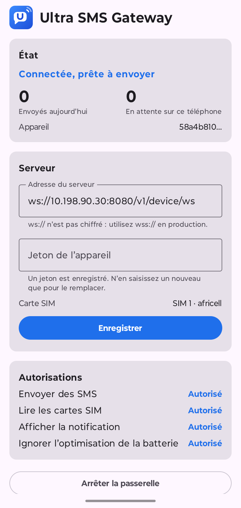

<p align="center">
  
</p>

<h1 align="center">Ultra SMS Gateway · Android</h1>

<p align="center">
  The phone side of <a href="https://github.com/Philippe-Rusare/ultra-sms-gateway">Ultra SMS Gateway</a>:
  it turns an Android phone and its SIM card into an SMS sender for your own server.
</p>

<p align="center">
  <a href="LICENSE"></a>
  
</p>

<p align="center">
  
</p>

## What it does

Your applications queue SMS on the [gateway server](https://github.com/Philippe-Rusare/ultra-sms-gateway).
This app keeps a connection open to that server, receives the messages, sends them with the phone's SIM
card, and reports back whether each one was sent and delivered. You pay the price of your operator's SMS
bundle instead of a commercial SMS API.

- **One screen**: pairing by QR code, SIM card, permissions, start and stop.
- **Runs with the screen off**: a foreground service keeps the connection alive, reconnects on its own and
  starts again after a reboot or an update.
- **Nothing is lost or sent twice**: results are stored on the phone until the server receives them, and a
  message pushed again by the server is recognised instead of being sent a second time.
- **Expired messages are not sent**: an OTP that waited too long is reported as expired instead of arriving late.
- **Long messages** are split into several SMS parts; the message counts as sent and delivered once every
  part is.
- **Dual SIM**: choose which SIM card sends.
- **Private by design**: message texts are erased once sent and never shown or logged; the device token is
  encrypted with the Android Keystore; nothing is backed up.
- English and French.

## Requirements

- An Android phone with **Android 8.0 or later** and a SIM card with an SMS bundle.
- A running [Ultra SMS Gateway server](https://github.com/Philippe-Rusare/ultra-sms-gateway) the phone can reach.

## Install

The app is installed by hand: Google Play does not allow apps that send SMS for a server.

### From a release (recommended)

1. On the phone, open the [latest release](https://github.com/Philippe-Rusare/ultra-sms-gateway-android/releases/latest)
   and download `ultra-sms-gateway-<version>.apk`.
2. Open the file. Android asks to allow installs from your browser or file manager the first time: allow it,
   then install.
3. Updates: download the new APK and install it over the old one; settings are kept.

Or from a computer, with the phone connected by USB and USB debugging enabled:

```bash
adb install -r ultra-sms-gateway-0.1.0.apk
```

Release APKs are signed with the project's release key. A version you built yourself in debug mode is
signed with another key: uninstall it before installing a release (the server URL and token must then be
entered again).

### From the sources

1. Build the APK (JDK 17 or later, or Android Studio):

   ```bash
   ./gradlew assembleDebug
   ```

2. Install it on the phone, connected with USB debugging enabled:

   ```bash
   adb install -r app/build/outputs/apk/debug/app-debug.apk
   ```

   Or open the project in Android Studio and press **Run**.

## Set up

1. In the server dashboard, open **Devices → Add device with a QR code**.
2. In the app, tap **Scan the QR code** and point the camera at it: the server address and the device token
   are set for you. The code works once and expires after 10 minutes. (A phone that cannot scan can open the
   link shown under the QR code, or you can type the server URL and a token by hand. Use `wss://` in
   production; `ws://` is only for a local test.)
3. Under **Permissions**, allow each line: sending SMS, reading the SIM cards (to choose one), the
   notification and the battery optimisation exemption.
4. On a dual-SIM phone, choose the SIM card with the SMS bundle.
5. Tap **Start the gateway**. The state turns to **Connected, ready to send**, and the dashboard shows the
   phone online with its battery, signal and operator.

## Keep it running

The phone is a small server: treat it like one.

- **Dedicate the phone** to the gateway and keep it **on its charger**.
- **Allow the battery exemption** in the app. Some manufacturers add their own battery savers that stop
  background apps anyway (Xiaomi, Tecno, Infinix, Huawei…): see [dontkillmyapp.com](https://dontkillmyapp.com)
  for your model. Samsung, Motorola, Nokia and Pixel phones are the most reliable.
- **Raise Android's SMS limit.** By default Android asks for a confirmation after about 30 SMS in 30 minutes
  from the same app. With the phone connected by USB:

  ```bash
  adb shell settings put global sms_outgoing_check_max_count 10000
  ```

  ```bash
  adb shell settings put global sms_outgoing_check_interval_ms 60000
  ```

  The setting survives reboots; a factory reset restores the default.
- The app sends **one SMS every 3 seconds** at most. Operators may block a SIM card that sends bursts of
  identical messages.

## How it works

```
GatewayService (foreground)
 ├─ GatewayClient ── WebSocket ──▶ server: hello, send / ack, sent, delivered, failed, heartbeat
 ├─ send loop ─────▶ SmsSender ──▶ SmsManager (one message at a time)
 └─ SmsResultReceiver ◀── sent / delivered results of every part
            │
      GatewayEngine ── SQLite: messages seen, reports waiting for the server
```

| Package | Role |
|---|---|
| `protocol` | JSON frames of the [device protocol](https://github.com/Philippe-Rusare/ultra-sms-gateway/blob/main/docs/device-protocol.md). |
| `engine` | Message logic without Android: deduplication, expiry, multipart results, reports. Unit tested. |
| `data` | SQLite storage of messages and pending reports. |
| `net` | WebSocket client: reconnection with a growing delay, heartbeat. |
| `sms` | Sending through `SmsManager` and reading its results. |
| `service` | Foreground service and restart after boot. |
| `pairing` | Reads the pairing link of the QR code and exchanges its code for the device token. |
| `config` | Settings and the encrypted device token. |
| `ui` | The Compose screen. |

The connection protocol is the contract with the server: it is documented in the server repository,
[docs/device-protocol.md](https://github.com/Philippe-Rusare/ultra-sms-gateway/blob/main/docs/device-protocol.md).

## Development

```bash
./gradlew testDebugUnitTest   # unit tests (protocol, engine, result codes)
./gradlew assembleDebug       # debug APK
```

### Release builds (maintainers)

`./gradlew assembleRelease` signs the APK with the release key when it finds one, either in a
`keystore.properties` file at the project root (never committed):

```properties
storeFile=/absolute/path/to/ultra-sms-gateway-release.jks
storePassword=...
keyAlias=ultra-sms-gateway
keyPassword=...
```

or in the environment variables `RELEASE_STORE_FILE`, `RELEASE_STORE_PASSWORD`, `RELEASE_KEY_ALIAS` and
`RELEASE_KEY_PASSWORD` (for CI). Without a key, the release APK is left unsigned. The key and its password
must be backed up: an app signed with a lost key can never be updated in place on the phones.

To publish a version: raise `versionCode` and `versionName` in `app/build.gradle.kts`, add it to
[CHANGELOG.md](CHANGELOG.md), build, then attach the APK to a GitHub release tagged `v<version>`.

To try the app without a real server, start the server's demo profile on your computer
(see [Try it without a phone](https://github.com/Philippe-Rusare/ultra-sms-gateway#try-it-without-a-phone))
and point the app at `ws://<your computer's address>:8080/v1/device/ws`. On the Android emulator, the
computer is `10.0.2.2`, and SMS sent to another emulator's number (for example `+15555215556`) never leave
your machine.

Contributions are welcome: see [CONTRIBUTING.md](CONTRIBUTING.md).

## Responsible use

Sending application-to-person SMS through consumer SIM cards may be restricted by your operator's terms
or by your country's telecom regulator. Read them before using this app in production, and only send
messages that recipients expect.

## License

[Apache License 2.0](LICENSE).
